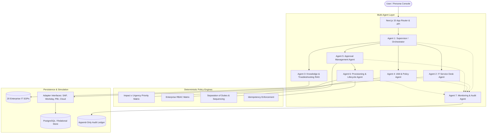

# System Architecture Specification
## IntelliDesk AI: Multi-Agent Enterprise Operations & Governance

---

## 1. Multi-Agent System Design

### 1.1 Supervisor / Orchestrator Agent
- **Contract**: Accepts employee input and current conversational session context.
- **Intent Recognition**: Routes to Incident Triage, Access Request, or Troubleshooting.
- **Guardrails**:
  - Rejects prompt injections ("bypass approval", "ignore rules", "grant root").
  - Intercepts conversational termination claims ("I quit") and routes to authoritative HR channels.
  - Never approves requests or executes simulated provisioning directly.

### 1.2 IT Service Desk Agent
- **Classification Engine**: Normalizes user input into 9 standardized categories: `Hardware`, `Software`, `Network`, `VPN`, `Email and Microsoft 365`, `Password and account support`, `ERP and SAP`, `Access requests`, `Other IT incidents`.
- **Deterministic Priority Matrix**:
  - `CRITICAL` Impact × `CRITICAL` Urgency → `P1` (4h SLA)
  - `HIGH` Impact × `HIGH` Urgency → `P2` (24h SLA)
  - `MEDIUM` Impact × `MEDIUM` Urgency → `P3` (48h SLA)
  - `LOW` Impact × `LOW` Urgency → `P4` (72h SLA)
- **Team Assignment**: Routes tickets deterministically to `Network Support`, `Infrastructure Ops`, `Enterprise Applications`, `Identity Services`, `End User Computing`, or `Cybersecurity SOC`.

### 1.3 Knowledge & Troubleshooting Agent (RAG)
- **Grounding Corpus**: 20 approved Standard Operating Procedures (SOPs).
- **Search Architecture**: Full-text and keyword similarity matching with stopword suppression and relevance scoring thresholds.
- **Attribution Contract**: Every troubleshooting response quotes Document ID, Version, Official Title, and Authoritative Manual Reference.
- **Escalation Path**: If matching confidence is below threshold, offers direct ticket escalation.

### 1.4 IAM & Policy Agent
- **RBAC Validator**: Matches employee role against enterprise entitlements.
- **Deny-by-Default**: Unmapped entitlements receive `OUT_OF_ROLE_REQUEST` flags and require multi-stage approval (Manager + Application Owner + Security Admin).

### 1.5 Approval Management Agent
- **Separation of Duties**: Prohibits requesters from approving their own submissions (`requester_id === approver_id -> DENIED`).
- **Sequencing**: Ensures Stage 1 is completed before Stage 2 is evaluated.
- **Provisioning Gate**: Rejections or pending stages strictly block execution.

### 1.6 Provisioning & Lifecycle Execution Agent
- **Adapter Pattern**: Extensible connector architecture (`SimulatedSAPConnector`, `SimulatedWorkdayConnector`, `SimulatedPowerBIConnector`, `SimulatedCloudConnector`).
- **Idempotency Keys**: Uses `IDEMP-{employee_id}-{permission_id}-{date}` to prevent duplicate grants.
- **JML Workflows**:
  - **Joiner**: Baseline role entitlements provisioned.
  - **Mover**: Delta entitlement calculation (obsolete permissions revoked, target role permissions granted).
  - **Leaver**: Verified HR exit event revokes 100% of active entitlements and sets account status to `TERMINATED`.

### 1.7 Monitoring & Audit Agent
- **Append-Only Ledger**: Logs Actor, Actor Type, Action, Entity Type, Entity ID, Outcome, Reason, Correlation ID, and Timestamp.
- **Zero-Mutation Rule**: Historical audit records cannot be modified or deleted.

---

## 2. Relational Database Schema (16 Tables)

1. `profiles`: Master employee identity catalog (20 synthetic employees).
2. `applications`: Enterprise software directory (10 applications).
3. `roles`: Business job titles across 5 departments.
4. `role_permissions`: 25+ RBAC entitlement mappings.
5. `employee_access`: Active and historical entitlements.
6. `tickets`: IT incidents, priorities, assigned teams, and resolution notes.
7. `access_requests`: Formal access requests with idempotency keys.
8. `approvals`: Multi-stage human approval records.
9. `provisioning_events`: Simulated connector execution logs.
10. `knowledge_documents`: 20 IT SOPs with full-text search vectors.
11. `knowledge_chunks`: Document chunks for semantic search.
12. `conversations`: Support chat session records.
13. `conversation_messages`: Multi-turn chat message history.
14. `agent_runs`: Agent workflow execution logs and state transitions.
15. `employee_lifecycle_events`: Joiner, Mover, and Leaver events.
16. `audit_logs`: Append-only security and operational audit trail.

